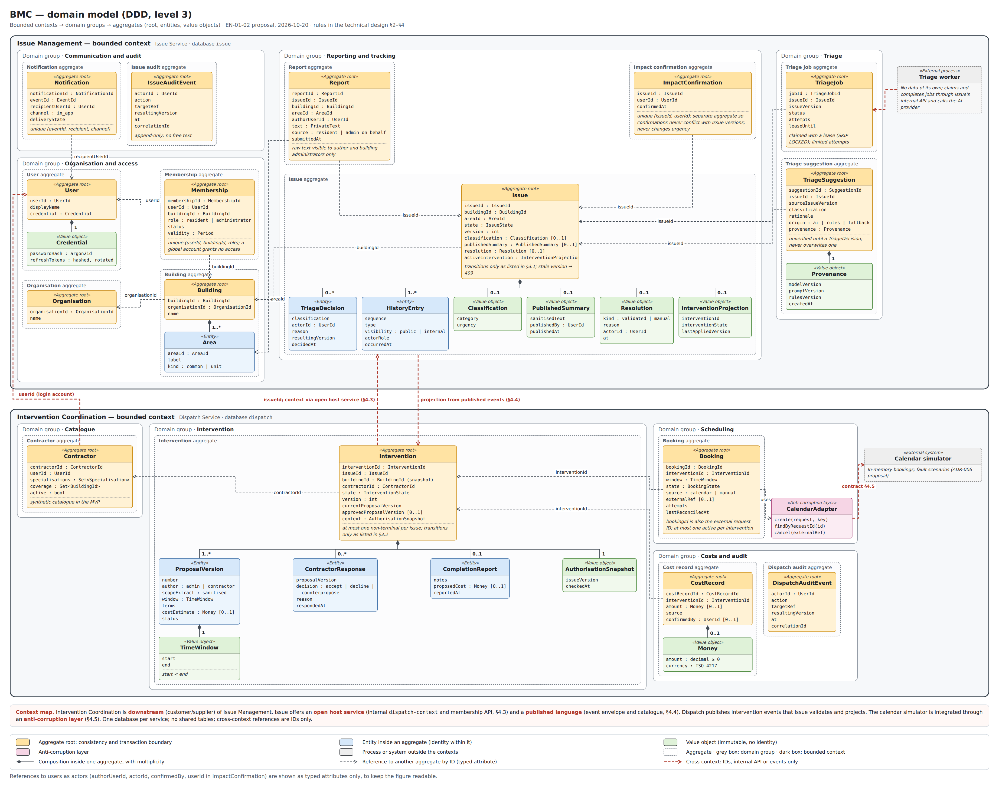
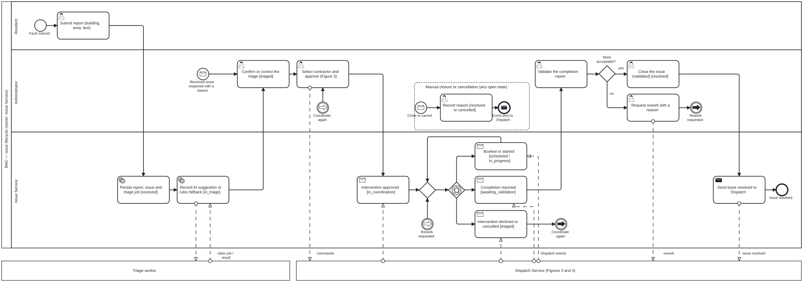
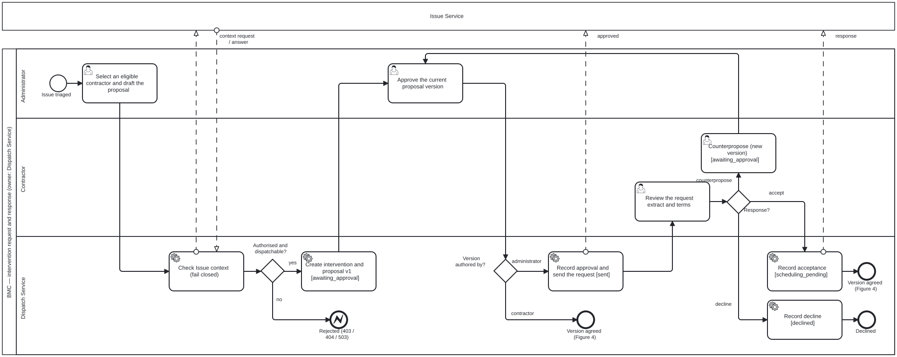

# Technical Design

**Status:** proposed conceptual design · Sprint 1, deliverable 7 · domain model, state rules and contract outlines reviewed in EN-01-02 · final stack and executable contracts pending

## 1. Context and boundaries

Residents, administrators and contractors use a proposed responsive web client. The backend coordinates issues and interventions, calls an AI provider and integrates an external calendar or simulator.

| Proposed unit | Responsibility / data it controls | Communication |
|---|---|---|
| Client | Forms, queues, states and corrections; no authority over permissions | Authenticated API |
| Issue Service | Buildings/memberships for authorisation, reports, issues, triage, summaries and confirmations | API; publishes events; receives authorised results |
| Dispatch Service | Catalogue, proposals, responses, bookings and costs | API; events; calendar adapter |
| Triage worker | Processes events, calls AI/rules, delivers versioned suggestions | Queue and internal Issue Service interface; does not write to other components' tables |
| Notification worker | Delivers idempotent notifications; final placement undecided | State events; proposed in-app channel |
| Broker | Transport and redelivery | Authenticated publishing/consumption |
| Storage | Persistence; one proposed technology to limit complexity | Schemas and credentials by responsibility |
| Calendar/simulator | Booking creation/query responses and simulatable failures | External contract with reference and idempotency key |

Issue and Dispatch are the **two proposed independently deployable backend components**. Workers may have their own processes; final grouping depends on ADR/DEC-04.

One database instance may host separate schemas in the academic environment; this does not authorise cross-writing. Make the shared operational dependency and compatible migrations explicit. Technology, queue and service-to-service authentication are undecided.

## 2. Domain model and data ownership

Reviewed on 2026-10-19 for EN-01-02 ([Issue: 20](https://github.com/Phenriquerafael/LABDSOF_GX/issues/20)) against journeys J1–J3 and the distinct steps in [vision 3–4.3](04-product-vision.md#3-journeys-and-responsibilities). Ownership follows the boundaries proposed in ADR-001.

*Figure 1 — Domain model, DDD level 3 ([editable HTML source](diagrams/domain-model.html); open the image for full size).* Each bounded context is one service with its own database. Domain groups collect related aggregates. A dashed frame is an aggregate, the consistency and transaction boundary: one root (yellow) plus its entities (blue) and value objects (green). Other aggregates are referenced by typed IDs only (grey dashed arrows); red arrows are the cross-context relations: IDs, the internal API (§4.3) or published events (§4.4), never shared tables. Two choices are deliberate. `ImpactConfirmation` and `TriageSuggestion` are separate aggregates, so concurrent confirmations and late AI results never conflict with the `Issue` version. `Booking` is separate from `Intervention`, so calendar retries and reconciliation do not lock the intervention. The tables below list the same entities with their journeys.

### 2.1 Issue Service

| Entity | Key fields and relationships | Journey / notes |
|---|---|---|
| Organisation | `id`, name; 1:N buildings | Can represent a property management company |
| Building | `id`, `organisationId`, name, areas; the authorisation scope | J1–J3 |
| Area | `id`, `buildingId`, label, kind (common area or unit reference) | J1 step 1; reports about private units remain an open question in [requirements](requirements.md#open-decisions) |
| User | `id`, display name, credentials (identity proposal: ADR-005 in [Issue: 30](https://github.com/Phenriquerafael/LABDSOF_GX/issues/30)) | A global account grants no access by itself |
| Membership | `userId`, `buildingId`, role (`resident` or `administrator`), status, validity; unique per user, building and role | Users N:M buildings. Contractors are not building members (see Dispatch) |
| Report | `id`, `issueId`, `buildingId`, `areaId`, `authorUserId`, private text, source (`resident` or `administrator_on_behalf`), `submittedAt` | J1 steps 1–2; raw text stays private ([access matrix](09-security-privacy.md#2-proposed-access-matrix)) |
| Issue | `id`, `buildingId`, `areaId`, state, `version`, category, urgency, triage source, optional published summary, resolution (kind, reason, actor, time), projection of the active intervention (`interventionId`, state, last applied `aggregateVersion`) | 1:N reports; J1 step 4, J2 |
| Triage job | `id`, `issueId`, `issueVersion`, status, attempts, lease expiry | Created with the report; claimed by the worker (ADR-003 in [Issue: 30](https://github.com/Phenriquerafael/LABDSOF_GX/issues/30)) |
| Triage suggestion | `issueId`, source issue version, category, urgency, rationale, origin (`ai`, `rules` or `fallback`), model/prompt/rules versions, time | Labelled unverified until a triage decision have been made ([AI Responsibility  Section: 2](06-responsible-ai-assessment.md#2-baseline-and-fallback)) |
| Triage decision | `issueId`, category, urgency, actor, reason, resulting version, time | The [DEC-10](planning/decisions-and-feedback.md#1-open-decisions) “triage decision”; distinct from the suggestion |
| Impact confirmation | Unique (`issueId`, `userId`), time; withdrawal deletes the row | J1 step 4; never changes urgency (RF-04) |
| Issue history entry | `issueId`, sequence, type, visibility (`public` or `internal`), actor role, time; includes projected Dispatch events | J1 step 4 and J2; residents see only public entries |
| Audit event | Actor, action, target, resulting version, time, `correlationId`; no free text | [T-10](09-security-privacy.md) |
| Notification | Unique (`eventId`, `recipientUserId`, channel), delivery state | [US-10](05-product-backlog.md), in-app channel [DEC-06](planning/decisions-and-feedback.md#1-open-decisions) |

### 2.2 Dispatch Service

| Entity | Key fields and relationships | Journey / notes |
|---|---|---|
| Contractor | `id`, `userId` (reference to an Issue account), specialisations, coverage (building IDs), active flag | Synthetic catalogue [US-06](05-product-backlog.md); the `userId` link is how a contractor's login maps to assignments |
| Intervention | `id`, `issueId`, `buildingId` (snapshot taken from the authorisation context, 4.3), `contractorId`, state, `version`, current and approved proposal versions | Issue 0:N interventions; at most one non-terminal intervention per issue |
| Proposal version | `interventionId`, version number, author (`administrator` or `contractor`), sanitised scope extract, proposed window, terms, optional cost estimate, status | A counterproposal is a new version [DEC-10](planning/decisions-and-feedback.md#1-open-decisions). The extract is written by the administrator; raw report text is never copied |
| Contractor response | `interventionId`, proposal version, decision (`accept`, `decline`, `counterpropose`), reason, time | The [DEC-10](planning/decisions-and-feedback.md#1-open-decisions) “acceptance” |
| Booking | `id` (also the external request ID), `interventionId`, window, state, source (`calendar` or `manual`), external reference, attempts, last reconciliation time | Intervention 0:N bookings, at most one active; the [DEC-10](planning/decisions-and-feedback.md#1-open-decisions) “booking confirmation” |
| Completion report | `interventionId`, notes, optional proposed cost, time | The DEC-10 “completion report”; does not close the issue |
| Cost record | `interventionId`, amount ≥ 0 or empty, currency, source, confirming actor; corrections audited | US-11 [Should](requirements.md) |
| Audit event | As in Issue, for Dispatch actions | [T-10](09-security-privacy.md) |

Both services also hold technical tables for the asynchronous workflow (outbox, processed event IDs, idempotency keys); see [Section: 5](#5-asynchronous-workflow-and-consistency).

### 2.3 Cardinalities and ownership rules

- Organisation 1:N buildings; building 1:N areas; users N:M buildings through memberships; issue 1:N reports, 0:N interventions (at most one non-terminal); intervention 1:N proposal versions and 0:N bookings (at most one active).

- References across services are IDs only. Neither service reads or writes the other's database; Issue's state reflects Dispatch only through events that Issue validates and applies to its own data ([Section: 3.3](#33-invalid-and-concurrent-transitions),[Section: 4.4](#44-event-contracts)).

- `buildingId` never changes for an issue, so Dispatch may keep it as a snapshot for filtering and audit. Memberships are not copied: they are checked against Issue for each administrator command [Section: 4.3](#43-how-dispatch-obtains-trustworthy-authorisation-context).

Changes from the previous draft, found in the journey review: areas made explicit (J1 step 1); a contractor-to-account link added so J3 assignment can be checked; proposal versions separated from the intervention (J3 step 2); triage decision separated from triage suggestion and completion report from cost record [DEC-10](planning/decisions-and-feedback.md#1-open-decisions); issue history made a projection that includes Dispatch events.

## 3. States and business rules

The rules below implement the step definitions in [Produc Vision Section 4.3](04-product-vision.md#43-distinct-steps-dec-10). They are proposals for DEC-10 and still need validation with administrators and contractors.

### 3.1 Issue states (owner: Issue)

The figures in this section are BPMN 2.0 collaboration diagrams. Lanes show who acts. A state in brackets, such as `[triaged]`, is the state the issue or intervention enters at that step. Services that are not the owner are drawn as collapsed pools; dashed message flows are the events and calls in [§4](#4-api-and-contract-outline-no-executable-contract-yet). Link events (arrow circles) join paths that would otherwise cross the whole figure. The transition tables are the normative rules; the figures illustrate them. The `.bpmn` sources open in [bpmn.io](https://demo.bpmn.io/) or Camunda Modeler; re-export the SVG after editing.

*Figure 2 — Issue lifecycle ([BPMN source](diagrams/issue-lifecycle.bpmn)).* The event-based gateway waits for the next Dispatch event: booking confirmed or work started loops back, a decline or cancellation returns the issue to coordination, and a completion report goes to validation. The event sub-process covers manual closure or cancellation from any open state.

| From | Trigger | Actor | To | Rule |
|---|---|---|---|---|
| — | `POST /reports` | Resident member, or administrator on behalf | `received` | Report, issue, triage job and outbox row in one transaction; never waits for AI |
| `received` | Suggestion or fallback recorded | Triage worker via internal API | `in_triage` | Ignored if the issue version has moved on |
| `received`, `in_triage`, `triaged` | Triage decision | Building administrator | `triaged` | Records actor, reason and new version; manual triage works without a suggestion |
| `triaged` | `InterventionApproved` event | Dispatch | `in_coordination` | Only when the event's `issueId` and `buildingId` match the issue |
| `in_coordination`, `scheduled`, `in_progress` | `InterventionDeclined` or `InterventionCancelled` | Dispatch | `triaged` | Visible “needs a contractor” status; manual coordination remains possible. While Dispatch reports `InterventionCancellationPending`, the state is kept and history shows the pending cancellation |
| `in_coordination` | `BookingConfirmed` (external or manual) | Dispatch | `scheduled` | Manual confirmation is shown as manual, never as synchronised |
| `scheduled` | `InterventionStarted` | Dispatch | `in_progress` | — |
| `scheduled`, `in_progress` | `CompletionReported` | Dispatch | `awaiting_validation` | Not a closure |
| `awaiting_validation` | `ReworkRequested` | Dispatch | `in_progress` | Reason required (in Dispatch) |
| `awaiting_validation` | `POST /issues/{id}/closure` with kind `validated` | Building administrator | `resolved` | Unknown cost does not block closure |
| Any open state | `POST /issues/{id}/closure` with kind `manual` | Building administrator | `resolved` | Justification required; an active intervention is cancelled through `IssueResolved` |
| Any open state | `POST /issues/{id}/cancellation` | Building administrator | `cancelled` | Reason required (for example duplicate or not actionable); same propagation |
| `resolved` | `POST /issues/{id}/reopening` | Building administrator | `in_triage` | Reason required; earlier interventions stay closed in history; a new intervention is needed |

“Open” means every state except `resolved` and `cancelled`. `cancelled` is terminal in this proposal: reopening it is rejected and a new report is created instead (to validate in DEC-10). The impact counter and notifications never change state.

### 3.2 Intervention states (owner: Dispatch)

*Figure 3 — Request, approval and response ([BPMN source](diagrams/intervention-request.bpmn)).* Dispatch checks the Issue context before creating anything (§4.3). A counterproposal returns to approval, and approving a contractor-authored version leads straight to booking. A change of terms by the administrator before the response (`POST …/proposals`) is not drawn.

*Figure 4 — Booking, execution and closure ([BPMN source](diagrams/intervention-booking.bpmn)).* The booking outcomes and reconciliation follow §4.5: a timeout or invalid answer is reconciled before any re-send, and a conflict or exhausted retries go to the administrator. The cancellation event sub-process applies in any active state before the completion report. The `discrepancy` case from §4.5 is not drawn.

| From | Command or event | Actor | To | Rule |
|---|---|---|---|---|
| — | `POST /interventions` | Building administrator | `awaiting_approval` | Issue context says the issue is dispatchable (`triaged` or `in_coordination`) and has no other non-terminal intervention; contractor eligible (US-06); creates proposal version 1. Selection sends nothing |
| `awaiting_approval` | `POST …/approval` for the current version | Building administrator | `sent`, or `scheduling_pending` if the version was authored by the contractor | Approves exactly one version. Approving a contractor's counterproposal records that version as the agreed terms, so the counterproposal counts as the contractor's acceptance; the booking request starts |
| `awaiting_approval`, `sent` | `POST …/proposals` (changed terms) | Building administrator | `awaiting_approval` | New version; any earlier approval is invalidated (US-07) |
| `sent` | `POST …/response` `accept` for the approved version | Assigned contractor | `scheduling_pending` | Records acceptance; Dispatch creates the booking request asynchronously (4.5) |
| `sent` | `POST …/response` `counterpropose` | Assigned contractor | `awaiting_approval` | New version authored by the contractor; needs new approval |
| `sent` | `POST …/response` `decline` | Assigned contractor | `declined` | Terminal; the administrator may create another intervention |
| `scheduling_pending` | Calendar outcome `confirmed`, or `POST …/manual-confirmation` | Calendar adapter, or building administrator | `booked` | Manual confirmation needs window, source and reason, and suspends automatic creation until reconciliation (4.5) |
| `scheduling_pending` | Calendar conflict, invalid data or exhausted retries | Calendar adapter | `scheduling_pending` | Booking marked `rejected`, `failed` or `uncertain` with the reason visible; the administrator retries, confirms manually or cancels |
| `booked` | `POST …/start` | Assigned contractor | `in_progress` | Optional step; completion may follow `booked` directly |
| `booked`, `in_progress` | `POST …/completion` | Assigned contractor, or administrator with a reason | `completion_reported` | Optional proposed cost |
| `completion_reported` | `POST …/rework` | Building administrator | `in_progress` | Reason required |
| `completion_reported` | `IssueResolved` or `IssueCancelled` event | Issue | `closed` | Terminal |
| `awaiting_approval`, `sent` | `POST …/cancellation`, or `IssueResolved` / `IssueCancelled` events | Building administrator, or Issue | `cancelled` | Reason recorded; the contractor is notified if the request was sent |
| `scheduling_pending`, `booked`, `in_progress` | Same | Same | `cancellation_pending` → `cancelled` | If a booking exists or may exist (request in flight or uncertain), Dispatch cancels or reconciles it first; the pending state stays visible until then |

Rescheduling after a booking confirmation is outside this baseline: the administrator cancels and creates a new intervention, or records a manual booking confirmation with the new window and source. Detailed rescheduling remains open in DEC-10. A contractor cannot cancel through the platform after acceptance; they contact the administrator (to validate, Q9).

### 3.3 Invalid and concurrent transitions

The tables in 3.1 and 3.2 are allow-lists. Anything not listed is rejected without side effects.

| Rule | Behaviour |
|---|---|
| Transition not allowed from the current state | `409` with code `INVALID_TRANSITION` and the current state |
| Stale version | Every state-changing command sends the version it was based on (`If-Match`); a mismatch returns `409` `VERSION_CONFLICT` with the current version and changes nothing |
| Wrong actor | `403`, or `404` when the resource is outside the actor's scope (no enumeration) |
| Repeated command | Same `Idempotency-Key` and same body returns the original result with no new effect; same key with a different body returns `422` `IDEMPOTENCY_KEY_REUSED` (4.1) |
| Duplicate event | Receiver records `eventId` in the same transaction as the effect; a duplicate is acknowledged with no effect |
| Older event | Issue applies a Dispatch event to its projection only if `aggregateVersion` is greater than the last one applied for that intervention; an older one goes into history only. Events carry the full new intervention state, so a missing intermediate event does not corrupt the projection |
| Late AI result | A suggestion based on an older issue version, or arriving after a triage decision, is stored but does not change category, urgency or state |

Representative races and their outcomes:

| Race | Outcome |
|---|---|
| Two administrators approve the same version at the same time | One transaction wins; the other receives `409` `VERSION_CONFLICT` (or the original result if it reused the same idempotency key). One request is sent |
| Administrator changes the terms (new version) while the contractor accepts the previous version | If the acceptance commits first, the change of terms fails with `409` `INVALID_TRANSITION` (already `scheduling_pending`); if the new version commits first, the acceptance fails with `409` `VERSION_CONFLICT` |
| Contractor accepts while the administrator cancels | Whichever commits first wins; the other gets `409` `INVALID_TRANSITION`. If cancellation wins, no booking request is created |
| Completion report arrives while cancellation is pending | Rejected with `409`; the cancellation completes first |
| Administrator closes the issue manually while Dispatch is booking | Issue commits `resolved` and emits `IssueResolved`; Dispatch moves the intervention to `cancellation_pending` and cancels or reconciles the booking. Issue history shows the cancellation as pending until Dispatch reports it |
| Validated closure attempted before `CompletionReported` reaches Issue | Rejected with `409` (issue not yet `awaiting_validation`); the UI shows the last update time (eventual consistency) |
| Manual booking confirmation while an automatic request is uncertain | Manual confirmation is stored; automatic re-sending stops; reconciliation runs, and if it finds an external booking the discrepancy is shown to the administrator. It is never shown as a second booking |

## 4. API and contract outline (no executable contract yet)

The [access matrix](09-security-privacy.md#2-proposed-access-matrix) defines policy; the tables below apply it to operations. Functional criteria remain in the [backlog](05-product-backlog.md#4-stories-and-criteria). Request, response, event and error examples for the principal journey and a walkthrough of failure and denied-access scenarios are in the [contract examples annex](07a-contract-examples.md). The executable OpenAPI is produced with the implementation; this outline is not production-complete (excluded by EN-01-02).

### 4.1 Conventions

| Topic | Proposal |
|---|---|
| Identifiers | UUIDv7 strings generated by the owning service ([RFC 9562](https://www.rfc-editor.org/rfc/rfc9562)); opaque to clients, never sequential integers |
| Time | RFC 3339 timestamps in UTC |
| Versions | Integer `version` per aggregate (issue, intervention), returned as `ETag` and sent back as `If-Match` |
| Idempotency | `Idempotency-Key` header on every effectful `POST`, scoped per actor and operation, kept for 24 h. The header name follows the IETF draft [draft-ietf-httpapi-idempotency-key-header](https://datatracker.ietf.org/doc/draft-ietf-httpapi-idempotency-key-header/), which is expired and not an RFC; the replay and reuse rules in 3.3 are this project's own |
| Errors | `application/problem+json` ([RFC 9457](https://www.rfc-editor.org/rfc/rfc9457)) with extension members `code`, `correlationId` and, where relevant, `currentState` and `currentVersion`. Error bodies never include private text |
| Status codes | `400` validation; `401` unauthenticated; `403` forbidden; `404` unknown or outside scope; `409` `VERSION_CONFLICT` or `INVALID_TRANSITION`; `422` `IDEMPOTENCY_KEY_REUSED` or semantic rule; `503` `DEPENDENCY_UNAVAILABLE` (database, or Issue context for Dispatch). No success is returned unless the change is persisted |
| Correlation | `X-Correlation-Id` accepted or generated at the edge, returned in responses and copied into events |

### 4.2 Operations

| Operation | Service | Actor | Result |
|---|---|---|---|
| `POST /reports` | Issue | Resident member; administrator on behalf (source recorded) | `201` with report and issue IDs and state `received` after persistence |
| `GET /issues`, `GET /issues/{id}`, `GET /issues/{id}/history` | Issue | Members and assigned contractor per matrix | Filtered by membership; role-specific projection (residents: public history only) |
| `POST /issues/{id}/triage` | Issue | Building administrator | Category, urgency and reason; `If-Match` |
| `POST /issues/{id}/publication` | Issue | Building administrator | Sanitised summary visible to the same building |
| `PUT` / `DELETE /issues/{id}/impact` | Issue | Resident of the building | One contribution per user; count only, no identities |
| `POST /issues/{id}/associations` | Issue | Building administrator | Audited link or reversal (US-05, Should) |
| `POST /issues/{id}/closure` | Issue | Building administrator | Kind `validated` or `manual` (with justification); `If-Match` |
| `POST /issues/{id}/cancellation` | Issue | Building administrator | Reason; `If-Match` |
| `POST /issues/{id}/reopening` | Issue | Building administrator | Reason; `If-Match` |
| `GET /notifications` | Issue | Any authenticated user | Own notifications only |
| `GET /contractors?issueId=` | Dispatch | Building administrator | Eligible contractors with the criteria used; unknown data not invented |
| `POST /interventions` | Dispatch | Building administrator | Contractor, scope extract, window, terms; state `awaiting_approval` |
| `GET /interventions?issueId=`, `GET /interventions?assigned=me`, `GET /interventions/{id}` | Dispatch | Building administrator; assigned contractor | Contractors see only their assignments and the extract |
| `POST /interventions/{id}/proposals` | Dispatch | Building administrator | New version with changed terms |
| `POST /interventions/{id}/approval` | Dispatch | Building administrator | Approves a named `proposalVersion`; `If-Match`; idempotent |
| `POST /interventions/{id}/response` | Dispatch | Assigned contractor | `accept`, `decline` or `counterpropose` for a named version |
| `POST /interventions/{id}/manual-confirmation` | Dispatch | Building administrator | Window, source and reason; booking source `manual` |
| `POST /interventions/{id}/start` | Dispatch | Assigned contractor | Work started |
| `POST /interventions/{id}/completion` | Dispatch | Assigned contractor; administrator with a reason | Completion report, optional proposed cost |
| `POST /interventions/{id}/rework` | Dispatch | Building administrator | Reason |
| `POST /interventions/{id}/cancellation` | Dispatch | Building administrator | Reason; may answer with `cancellation_pending` |
| `PUT /interventions/{id}/cost` | Dispatch | Building administrator confirms; contractor proposes | Audited correction (US-11, Should) |

Internal endpoints accept only service tokens with the right audience (proposal: ADR-005 in #30) and are not exposed through the public proxy:

| Internal operation | Provider | Caller | Purpose |
|---|---|---|---|
| `POST /internal/triage-jobs/claim`, `POST /internal/triage-jobs/{id}/complete` | Issue | Triage worker | Claim jobs and submit versioned results (ADR-003 in #30) |
| `GET /internal/issues/{id}/dispatch-context?actorId=` | Issue | Dispatch | Authorisation context (4.3) |
| `GET /internal/users/{id}/memberships` | Issue | Dispatch | Building IDs an administrator manages, for list filtering (4.3) |
| `POST /internal/events` | Issue and Dispatch | The other service's relay | Receives envelopes (4.4); idempotent by `eventId` |

### 4.3 How Dispatch obtains trustworthy authorisation context

Dispatch must know that the caller administers the issue's building and that the issue can be dispatched, without reading or writing Issue's data.

1. **Identity.** Dispatch verifies the user's access token locally (Issue's public key; ADR-005 in #30) and takes only `sub` from it. Roles, building IDs or issue states sent by the client are never used as authority.
2. **Contractor commands** are authorised from Dispatch's own data: the intervention's `contractorId` must map to a contractor whose `userId` equals `sub` and who is active. No call to Issue is needed, so contractors can respond while Issue is down.
3. **Administrator commands** call `GET /internal/issues/{id}/dispatch-context?actorId={sub}` with a Dispatch service token. Issue answers from its own data: `issueId`, `buildingId`, state, `version`, category, urgency, area label, published summary (never raw report text), the actor's roles in that building and a `dispatchable` flag. Dispatch requires `administrator` in `actorRoles`, plus `dispatchable` for creation.
4. **Snapshot.** Dispatch stores `buildingId`, the issue version and the check time on the intervention, in its own database, for audit and filtering. Every administrator write checks again, so a revoked membership takes effect at the next command.
5. **Reads.** Administrator lists are filtered by the building IDs from `GET /internal/users/{id}/memberships`. A cache of at most 30 s is allowed for reads only (value to confirm in EN-01-04); writes never use a cached answer.
6. **Fail closed.** If Issue does not answer within 2 s, or the answer is invalid, administrator commands return `503` `DEPENDENCY_UNAVAILABLE`. There is no fallback to client-supplied data.
7. **Back-propagation.** Dispatch changes Issue only by emitting events. Issue checks that each event's `issueId` and `buildingId` match its own records before applying it; a mismatch becomes a `failed` row for inspection.

Alternatives considered: memberships as token claims (rejected: the ADR-005 proposal resolves memberships on the server, and a 15-minute token would delay revocation); read-only access by Dispatch to Issue's database (rejected: breaks ownership in ADR-001 and couples schemas); a membership projection inside Dispatch fed by events (kept as an option if Issue availability becomes a problem, at the cost of a revocation delay). Open details: projection versus per-request calls (DEC-04, EN-01-03); service key storage and rotation (EN-01-04); whether contractor accounts are scoped to an organisation (DEC-07).

### 4.4 Event contracts

Envelope as in [5](#5-asynchronous-workflow-and-consistency). `schemaVersion` is an integer; a receiver that does not support a major version marks the delivery `failed` instead of guessing. Payloads carry IDs and states, not private text.

| Event | Producer | Consumers | Payload (beyond the envelope) |
|---|---|---|---|
| `ReportSubmitted` | Issue | Notification module | `reportId`, `issueId`, `areaId` |
| `IssueTriaged` | Issue | Notification module | Category, urgency, `decisionSource` (`human`) |
| `IssueSummaryPublished` | Issue | Notification module | Summary ID (the text is fetched under authorisation) |
| `IssueResolved` | Issue | Dispatch, notifications | Resolution kind (`validated` or `manual`), `activeInterventionId` |
| `IssueCancelled` | Issue | Dispatch, notifications | `activeInterventionId` |
| `IssueReopened` | Issue | Notifications | Reason code |
| `InterventionApproved` | Dispatch | Issue | `issueId`, `contractorDisplayName`, approved version, `interventionState` |
| `ContractorResponded` | Dispatch | Issue | Decision, proposal version, `interventionState` |
| `InterventionDeclined`, `InterventionCancellationPending`, `InterventionCancelled` | Dispatch | Issue | Reason code, `interventionState` |
| `BookingConfirmed` | Dispatch | Issue | Window, source (`calendar` or `manual`), `interventionState` |
| `BookingStateChanged` | Dispatch | Issue | Non-confirmed booking state (`requested`, `uncertain`, `rejected`, `failed`, `discrepancy`), `interventionState` |
| `InterventionStarted`, `CompletionReported`, `ReworkRequested` | Dispatch | Issue | `interventionState`; no cost to residents |

Every Dispatch event carries `issueId`, `buildingId` and the full new `interventionState`, with the intervention as `aggregateId`, so Issue can apply it by version (3.3).

### 4.5 Calendar/simulator contract outline

The adapter in Dispatch talks to the calendar simulator (ADR-006 in #30) through a provider-neutral port. A real calendar (US-13) must meet the same contract.

| Operation | Request | Possible outcomes |
|---|---|---|
| `POST /bookings` | `Idempotency-Key` = booking ID (stable across retries); `requestId`, `contractorRef`, window, building code, sanitised summary; no names, addresses or report text | `201` confirmed with `externalRef`; `200` replay of the same booking; `409` slot conflict; `422` invalid request; `503` unavailable; timeout |
| `GET /bookings?requestId=` | Booking ID | The booking if it exists, or an empty result; used for reconciliation |
| `POST /bookings/{externalRef}/cancellation` | `Idempotency-Key` | `200` cancelled, `404` unknown, `503`, timeout |

Dispatch treats a `2xx` answer as valid only if it echoes `requestId`, has a non-empty `externalRef` and returns the requested window. Otherwise the answer counts as invalid.

| Outcome | Booking state | Next action |
|---|---|---|
| Valid confirmation | `confirmed` (source `calendar`) | Emit `BookingConfirmed` |
| Slot conflict | `rejected` | Visible reason; administrator retries, confirms manually or cancels |
| `422` | `failed` | Contract defect: alert operators; no automatic retry |
| `503` or connection refused | `requested` | Retry with backoff (4.6) |
| Timeout, late answer or invalid `2xx` | `uncertain` | Reconcile with `GET /bookings?requestId=` before any re-send: found → `confirmed`; not found → re-send with the same key; unavailable → stay `uncertain` and retry later |
| Retries exhausted | `failed` | Intervention stays `scheduling_pending` with “needs manual action” |
| Confirmed booking missing at the provider (for example after a simulator restart) | `discrepancy` | Found by reconciliation on demand and before the booked window; shown to the administrator; never silently recreated or downgraded |

The same idempotency key makes a delayed or repeated request create at most one booking (NFR-11, T-04). A calendar slot alone does not prove contractor availability; acceptance comes first (3.2).

### 4.6 Retry, timeout and lease values (proposal)

These values answer EN-01-01's open detail EN01-U7 (#30) as a starting proposal. They will be calibrated in the spike and the first asynchronous slice, and are not measured results.

| Mechanism | Proposed value |
|---|---|
| Outbox relay | Poll every 1 s; backoff 2 s doubling up to 5 min; 10 attempts (about 24 min), then `failed` with controlled replay |
| Triage job | Lease 45 s (two AI attempts at the 10 s NFR-03 timeout plus rules); 3 claims, then `failed` and visible manual triage |
| Calendar call | 5 s timeout; 5 attempts with backoff 5 s doubling up to 2 min, reconciling before each re-send; then booking `failed` |
| Dispatch → Issue context call | 2 s timeout; no retry inside the user request (`503`) |
| Retention | Idempotency keys 24 h; processed event IDs at least 7 days (longer than any retry window) |

## 5. Asynchronous workflow and consistency

1. Issue persists the report/issue and event record in the same transaction (proposed outbox).
2. The publisher sends ReportSubmitted; broker failure preserves the event for retry.
3. The worker validates schema, ID and version and applies the [AI/baseline/fallback workflow](06-responsible-ai-assessment.md#2-baseline-and-fallback), with the timeout defined in NFR-03.
4. The result reaches Issue's authorised internal interface; an old result does not replace a human correction.
5. Change events feed projections/notifications; consumers deduplicate by eventId.
6. Dispatch manages approval/acceptance and issues a calendar request only when eligible.

Proposed envelope: eventId, eventType, schemaVersion, aggregateId, aggregateVersion, buildingId, occurredAt, correlationId and minimal payload. Received building identifiers are also validated; they do not suffice as authorisation.

Retries use increasing delays and a configured limit; exhausted attempts go to a failure record/queue with controlled replay. Test crashes after persistence and before publication, repeated delivery and out-of-order events. Do not promise “exactly once” delivery; build idempotent effects.

## 6. External integration and degraded mode

The calendar/simulator must support requests with stable IDs, query/reconciliation and scenarios: success, timeout, unavailability, delay, incomplete/invalid response and scheduling conflict.

Timeout may occur after the external event is created; query/reconcile before retrying. Manual confirmation remains distinct from external synchronisation and suspends duplicate automatic creation until reconciliation. A calendar slot alone does not prove contractor availability.

AI unavailable: rules + manual review. Broker/worker unavailable: persisted report and pending/manual triage. Calendar unavailable: pending/manual. Notification failure: status remains queryable. Database unavailable: explicit error without false acknowledgement.

## 7. Proposed deployment and operations

- Containers: client, Issue, Dispatch, workers, broker, database and simulator according to the profile.
- Expose only necessary endpoints; database/broker on an internal network.
- Configuration per environment; secrets injected outside Git; least-privilege service identities.
- CI builds/tests/images; demonstration environment to be chosen (DEC-04); no Kubernetes commitment.
- Migrations owned by each schema owner, health/readiness and compatible versions for independent deployment.
- Structured logs with correlation ID; metrics for errors, latency, queue, retries, fallback, pending bookings and failed notifications.
- Initial dashboard in S2; backup/restore and rollback documented/exercised before release.

## 8. Gaps and validation

Undecided: stack, broker, database, hosting, identity, publishing mechanism, final schemas and rescheduling after a booking confirmation (3.2, DEC-10). Record alternatives and consequences in [ADRs](adr/README.md). The physical data model and executable contracts do not yet exist.

See [requirements](requirements.md), [security](09-security-privacy.md) and [walking skeleton](10-walking-skeleton.md).
